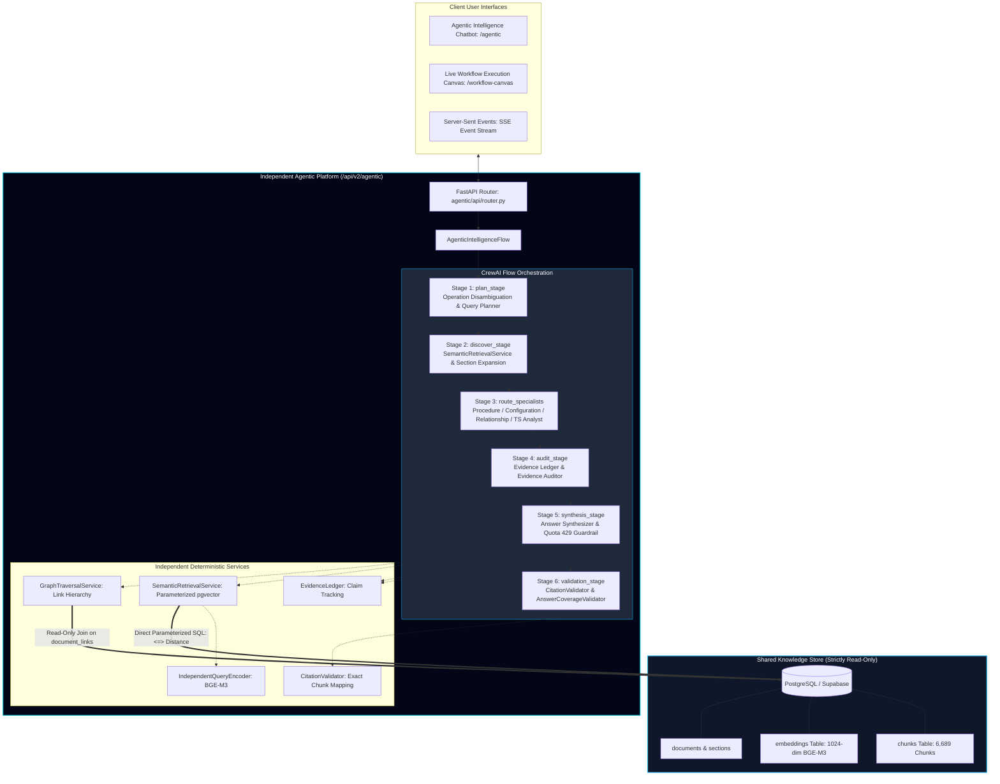
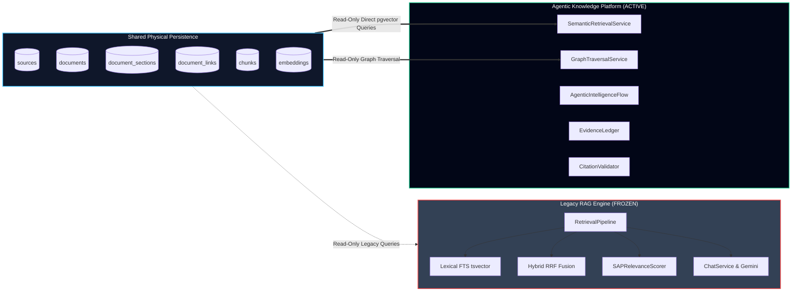

# SAP Utilities Agentic Knowledge Intelligence Platform (CrewAI v2) — Code-Verified Architecture Documentation

> **Status:** `PRODUCTION_VERIFIED`  
> **Platform Version:** 2.0.0  
> **Orchestration Framework:** CrewAI Flow (`Flow[AgenticFlowState]`) & Multi-Agent Crews  
> **Knowledge Store:** PostgreSQL 17 / pgvector (6,689 Stored Chunks, BGE-M3 1024-dim Vectors, Read-Only Boundary)  
> **Retrieval Engine:** Independent Parameterized Semantic Vector Search (`SemanticRetrievalService`) with Deep HNSW Recall (`ef_search=200`), Procedural Section Expansion, and Graph Traversal  
> **Inference Providers:** Groq (`qwen/qwen3.8-27b` default) with Automatic Google Gemini (`gemini-3.5-flash`) Failover  
> **Grounding Integrity:** Deterministic Evidence Ledger, Strict Bracketed Citation Validator (`CitationValidator`), and Automated HTTP 429 Evidence-Only Safeguard  
> **Test Suite Status:** 133/133 Unit & Regression Tests Passing (`tests/`)

---

## Table of Contents

1. [System Overview & Architectural Paradigm](#1-system-overview--architectural-paradigm)
2. [Repository Map & Component Inventory](#2-repository-map--component-inventory)
3. [Shared Knowledge Store & Read-Only Database Boundary](#3-shared-knowledge-store--read-only-database-boundary)
4. [Independent Retrieval Architecture](#4-independent-retrieval-architecture)
5. [CrewAI Specialist Agent Architecture](#5-crewai-specialist-agent-architecture)
6. [Orchestration Sequence & State Flow](#6-orchestration-sequence--state-flow)
7. [Evidence Ledger & Inter-Agent Handoffs](#7-evidence-ledger--inter-agent-handoffs)
8. [Evidence Auditing & Gap Routing](#8-evidence-auditing--gap-routing)
9. [Answer Synthesis & Grounding Validation](#9-answer-synthesis--grounding-validation)
10. [Runtime Observability & Live Execution Canvas](#10-runtime-observability--live-execution-canvas)
11. [API Routes & Frontend Integration](#11-api-routes--frontend-integration)
12. [Security, Invariant Enforcement & Strict Isolation Audit](#12-security-invariant-enforcement--strict-isolation-audit)
13. [Comparative Benchmark & Evaluation Metrics](#13-comparative-benchmark--evaluation-metrics)
14. [Operational Guide & Runbook](#14-operational-guide--runbook)
15. [Known Limitations & Technical Roadmap](#15-known-limitations--technical-roadmap)
16. [Code-Verification Matrix](#16-code-verification-matrix)

---

## 1. System Overview & Architectural Paradigm

### 1.1 Why the Agentic Platform Exists
The **SAP Utilities Agentic Knowledge Intelligence Platform** was engineered to overcome the fundamental limitations of monolithic Retrieval-Augmented Generation (RAG) when applied to mission-critical enterprise ERP procedures:
1. **Procedural Complexity:** Complex utility procedures (e.g. Move-In Reversal via transaction `EC53E`, Move-Out Reversal via `EC58E`, or Reconnection Order processing) require distinguishing commercial contract lifecycle operations from physical device installation status. Monolithic RAG blends these into unstructured summaries.
2. **Hallucinated Citations:** Standard LLMs often cite nonexistent documents or misattribute prerequisites. The Agentic platform enforces deterministic claim-to-evidence validation where every citation `[N]` must resolve to an exact, stored chunk ID.
3. **Ambiguity Resolution:** Pre-retrieval operation disambiguation deconstructs user inquiries into candidate interpretations (e.g. reversing newly created contracts vs. reversing the end of contracts) before query execution.
4. **Provider Quota Resilience:** When upstream LLM providers return HTTP 429 rate limits, the platform avoids hallucinated answers by automatically switching to a verified **Evidence-Only Mode** backed by audited PostgreSQL evidence.

### 1.2 High-Level System Architecture & Knowledge Boundary



### 1.3 Key Architectural Invariants
- **Read-Only Database Boundary:** The platform executes read-only SQL queries (`SELECT`) over `chunks`, `embeddings`, `documents`, `document_sections`, and `document_links`. It never mutates records, updates vector columns, or recrawls documents.
- **Zero Legacy RAG Code in Execution Path:** The platform does not import, instantiate, or invoke `RetrievalPipeline`, `DenseRetriever`, `LexicalRetriever`, `HybridRetriever`, `SAPRelevanceScorer`, `FastFeatureReranker`, or `ChatService`.
- **Deterministic Validation:** Validation of citations, token budgets, and coverage is executed by deterministic Python algorithms—not left to stochastic LLM self-evaluation.

---

## 2. Repository Map & Component Inventory

All agentic source files reside within `sap_rag/agentic/`:

| Module Path | Primary Symbols | Architectural Responsibility | Verification Status |
|---|---|---|---|
| `sap_rag/agentic/orchestration/flow.py` | `AgenticIntelligenceFlow`, `AgenticFlowState`, `disambiguate_sap_operation` | CrewAI Flow orchestrator controlling state transitions and stages | `VERIFIED_IN_CODE` |
| `sap_rag/agentic/orchestration/agents.py` | `AgenticSpecialistsFactory`, `get_agentic_llm` | Specialist agent role definitions, system goals, LLM client | `VERIFIED_IN_CODE` |
| `sap_rag/agentic/orchestration/run_manager.py` | `WorkflowRunManager` | Lifecycle management for workflow runs, graph state, and SSE event streaming | `VERIFIED_IN_CODE` |
| `sap_rag/agentic/orchestration/tools.py` | `search_sap_documentation`, `expand_document_relationships` | CrewAI tools exposing independent retrieval to agents | `VERIFIED_IN_CODE` |
| `sap_rag/agentic/retrieval/service.py` | `SemanticRetrievalService` | Parameterized direct pgvector nearest-neighbor search with section expansion | `VERIFIED_IN_CODE` |
| `sap_rag/agentic/retrieval/encoder.py` | `IndependentQueryEncoder` | Singleton query encoder using BAAI/bge-m3 with L2 normalization | `VERIFIED_IN_CODE` |
| `sap_rag/agentic/retrieval/traversal.py` | `GraphTraversalService` | Document hierarchy and hyperlink graph expansion | `VERIFIED_IN_CODE` |
| `sap_rag/agentic/retrieval/context_builder.py` | `EvidenceContextBuilder`, `parse_chunk_components`, `create_clean_excerpt` | Safe request-time chunk excerpting, header stripping, token budgeting | `VERIFIED_IN_CODE` |
| `sap_rag/agentic/ledger/ledger.py` | `EvidenceLedger` | In-memory ledger tracking claims, evidence provenance, and contradictions | `VERIFIED_IN_CODE` |
| `sap_rag/agentic/validators/citation_validator.py` | `CitationValidator` | Deterministic verification matching citations `[N]` to verified chunk IDs | `VERIFIED_IN_CODE` |
| `sap_rag/agentic/validators/coverage_validator.py` | `AnswerCoverageValidator` | Subquestion coverage evaluation and unaddressed topic detection | `VERIFIED_IN_CODE` |
| `sap_rag/agentic/validators/budget_controller.py` | `ExecutionBudgetController` | Request-scoped timeout and investigation round enforcement | `VERIFIED_IN_CODE` |
| `sap_rag/agentic/schemas/contracts.py` | `QueryPlan`, `EvidenceItem`, `FinalAgenticResponse`, `CitationItem` | Strongly-typed Pydantic schemas and system enums | `VERIFIED_IN_CODE` |
| `sap_rag/agentic/schemas/workflow_events.py` | `WorkflowEvent`, `RunSnapshot`, `WorkflowNode`, `WorkflowEdge` | Graph state and SSE observability event models | `VERIFIED_IN_CODE` |
| `sap_rag/agentic/security/guardrails.py` | `SecurityGuardrails` | Query sanitization, SQL safety, and prompt injection defense | `VERIFIED_IN_CODE` |
| `sap_rag/agentic/api/router.py` | `agentic_router` | FastAPI endpoints mounted at `/api/v2/agentic` | `VERIFIED_IN_CODE` |

---

## 3. Shared Knowledge Store & Read-Only Database Boundary

### 3.1 Shared Assets vs. Architectural Boundary
The Agentic platform shares **only the underlying PostgreSQL database assets** with the legacy system. The diagram below illustrates the exact boundary:



### 3.2 Read-Only Enforcement & Connection Pool
- Connection acquisition is managed via `DatabasePool.acquire()` (`sap_rag/database/connection.py`).
- All queries executed by `SemanticRetrievalService` and `GraphTraversalService` are parameterized `SELECT` statements.
- No `INSERT`, `UPDATE`, `DELETE`, or DDL statements exist in `sap_rag/agentic/`.

---

## 4. Independent Retrieval Architecture

### 4.1 Parameterized pgvector Search (`SemanticRetrievalService`)
Implemented in `sap_rag/agentic/retrieval/service.py`:
- **Query Encoder:** `IndependentQueryEncoder.get_instance()` encodes user subqueries into 1024-dimensional normalized vectors using PyTorch and `BAAI/bge-m3`.
- **Vector Operator:** Uses the native pgvector cosine distance operator `<=>`, which maps directly to the `idx_embeddings_vector_hnsw` index.
- **Deep Recall Configuration:** Sets `SET hnsw.ef_search = 200;` on every connection prior to vector querying to ensure thorough recall of granular procedural passages.
- **Similarity Formula:**
  $$\text{Cosine Similarity} = \max(0.0, 1.0 - \text{cosine\_distance})$$

### 4.2 Procedural Section Expansion
When candidate documents are discovered via vector similarity, `SemanticRetrievalService` executes a targeted secondary SQL query to retrieve substantive workflow sections for those specific documents (`service.py` lines 120–167):
- Headings targeted: `procedure`, `prerequisite`, `result`, `scope`, `use`, `feature`, `activities`, `reconnect`, `disconnect`, `order`, `entry`, `process flow`, `reversal`, `reverse`.
- **TOC Filtering:** If substantive procedure or prerequisite sections exist for a document, pure table-of-contents or overview navigation chunks (`chunk_index` 0 and 1) are automatically pruned, preventing navigation links from displacing procedural text.

### 4.3 Graph Traversal (`GraphTraversalService`)
Implemented in `sap_rag/agentic/retrieval/traversal.py`:
- Traverses documentation hyperlinks stored in `document_links` to recover related master data and configuration context.
- Traverses parent-child documentation trees via `documents.parent_id` and `documents.root_document_id`.

### 4.4 Header Stripping & Excerpting (`EvidenceContextBuilder`)
Stored chunks contain structured metadata headers (`[DOCUMENT]`, `[PATH]`, `[SECTION]`, `[CONTENT]`).
`EvidenceContextBuilder` (`sap_rag/agentic/retrieval/context_builder.py`):
1. Parses headers via `parse_chunk_components()` into discrete fields (`title`, `breadcrumb`, `section_heading`, `clean_body`).
2. Extracts clean excerpts (`create_clean_excerpt()`) truncated at natural sentence boundaries without losing procedural context.
3. Enforces request-scoped context token budgets (`AGENTIC_MAX_CONTEXT_TOKENS: 6000`).

---

## 5. CrewAI Specialist Agent Architecture

Specialist agents are constructed via `AgenticSpecialistsFactory` (`sap_rag/agentic/orchestration/agents.py`). Each agent possesses a narrow role, precise system instructions, and zero delegation:

### 5.1 Agent Responsibility Table

| Agent Name | Factory Method | Role & Goal | Active Activation Condition | Downstream Consumer |
|---|---|---|---|---|
| **Query Planner** | `create_query_planner()` | Deconstruct question intent, extract SAP entities, and generate 1–3 non-overlapping subquestions | Every query (`plan_stage`) | `discover_stage` |
| **Semantic Discovery Worker** | `create_semantic_discovery_worker()` | Execute direct semantic vector searches and section expansion | Every query (`discover_stage`) | Context Builder & Specialists |
| **Procedure Analyst** | `create_procedure_analyst()` | Extract documented prerequisites, ordered procedural steps, transaction codes (e.g. `EC53E`, `EC58E`), and outcomes | `QueryIntent.PROCEDURAL` | `EvidenceLedger` & `audit_stage` |
| **Configuration Analyst** | `create_configuration_analyst()` | Identify Customizing IMG paths, parameters, indicators, and posting rules | `QueryIntent.CONFIGURATION` | `EvidenceLedger` & `audit_stage` |
| **Relationship Analyst** | `create_relationship_analyst()` | Trace dependencies across Business Partners, Contract Accounts, Installations, and Contracts | `QueryIntent.RELATIONSHIP` | `EvidenceLedger` & `audit_stage` |
| **Troubleshooting Analyst** | `create_troubleshooting_analyst()` | Identify diagnostic steps, error codes, and exception resolution workflows | `QueryIntent.TROUBLESHOOTING` | `EvidenceLedger` & `audit_stage` |
| **Evidence Auditor** | `create_evidence_auditor()` | Challenge claims, evaluate evidence sufficiency (`sufficient`, `partial`, `insufficient`), identify gaps | Every query (`audit_stage`) | `synthesis_stage` |
| **Answer Synthesizer** | `create_answer_synthesizer()` | Synthesize unified procedural answer with exact numbered citations `[1]`, `[2]` | Every query (`synthesis_stage`) | `validation_stage` |

### 5.2 Model Configuration & Failover (`get_agentic_llm`)
- **Primary LLM:** Groq `qwen/qwen3.8-27b` via OpenAI-compatible endpoint (`https://api.groq.com/openai/v1`).
- **Failover LLM:** Google Gemini `gemini-3.5-flash` via `google-genai` SDK.
- **Parameters:** `temperature = 0.1`, `max_tokens = 3000`, `timeout = 30s`.

---

## 6. Orchestration Sequence & State Flow

The complete execution workflow is managed by `AgenticIntelligenceFlow` (`sap_rag/agentic/orchestration/flow.py`):

```mermaid
sequenceDiagram
    autonumber
    participant U as User / Client
    participant API as router.py
    participant FLOW as AgenticIntelligenceFlow
    participant PLAN as Query Planner
    participant RET as SemanticRetrievalService
    participant SPEC as Specialist Analyst
    participant LED as EvidenceLedger
    participant AUD as Evidence Auditor
    participant SYN as Answer Synthesizer
    participant VAL as CitationValidator

    U->>API: POST /api/v2/agentic/runs (or /chat)
    API->>FLOW: kickoff_async(AgenticFlowState)
    
    rect rgb(30, 41, 59)
        note over FLOW, PLAN: Stage 1: Plan & Operation Disambiguation
        FLOW->>FLOW: disambiguate_sap_operation(query)
        FLOW->>PLAN: Formulate QueryPlan (1-3 Subquestions)
        PLAN-->>FLOW: QueryPlan Artifact
    end

    rect rgb(15, 23, 42)
        note over FLOW, RET: Stage 2: Deterministic Semantic Discovery
        FLOW->>RET: Direct pgvector search (Central + Subqueries)
        RET->>RET: Section Expansion (Procedure / Prerequisite chunks)
        RET-->>FLOW: Raw Evidence Items
        FLOW->>FLOW: EvidenceContextBuilder (Deduplicate & Excerpt)
    end

    rect rgb(30, 41, 59)
        note over FLOW, SPEC: Stage 3: Specialist Routing & Reasoning
        FLOW->>SPEC: Route to Procedure / Config / Rel / TS Analyst
        SPEC->>SPEC: Analyze Evidence & Extract Atomic Claims
        SPEC-->>LED: Record Claims & Evidence Provenance
    end

    rect rgb(15, 23, 42)
        note over FLOW, AUD: Stage 4: Evidence Auditing & Gap Decision
        FLOW->>AUD: Evaluate Evidence Sufficiency & Gaps
        AUD-->>FLOW: Sufficiency Decision (SUFFICIENT / PARTIAL / INSUFFICIENT)
    end

    rect rgb(30, 41, 59)
        note over FLOW, SYN: Stage 5: Grounded Answer Synthesis
        alt Upstream Quota OK
            FLOW->>SYN: Synthesize Structured Answer with Citations [1], [2]
            SYN-->>FLOW: Grounded Answer Markdown
        else Upstream HTTP 429 Quota Exhausted
            FLOW->>FLOW: Switch to Evidence-Only Mode (Audited Source Passages)
        end
    end

    rect rgb(15, 23, 42)
        note over FLOW, VAL: Stage 6: Deterministic Validation & Assembly
        FLOW->>VAL: CitationValidator.validate_answer()
        VAL->>VAL: Verify [N] -> Chunk IDs & Check Invariants
        VAL-->>FLOW: ValidationReport
        FLOW->>FLOW: Assemble FinalAgenticResponse
    end

    FLOW-->>API: FinalAgenticResponse
    API-->>U: JSON Response & SSE Event Stream
```



---

## 7. Evidence Ledger & Inter-Agent Handoffs

### 7.1 Data Contracts & Pydantic Models
Inter-agent communication uses strongly-typed Pydantic models (`sap_rag/agentic/schemas/contracts.py`):
- **`EvidenceItem`:** Encapsulates retrieved chunks (`evidence_id`, `chunk_id`, `document_id`, `title`, `canonical_url`, `section_heading`, `clean_excerpt`, `clean_body`, `cosine_distance`, `similarity_score`).
- **`ClaimRecord`:** Represents an atomic fact asserted by an analyst (`claim_id`, `claim_text`, `claim_category`, `supporting_evidence_ids`, `verification_status`).
- **`CitationItem`:** Represents a verified bracketed citation (`citation_id`, `evidence_id`, `chunk_id`, `title`, `canonical_url`, `excerpt`, `cosine_distance`).

### 7.2 Evidence Ledger (`EvidenceLedger`)
Implemented in `sap_rag/agentic/ledger/ledger.py`:
- Maintains request-scoped evidence items and claims.
- Categorizes claims into: `prerequisites`, `ordered_steps`, `verification`, `limitations`, `configuration`, or `general`.
- Maps claims to supporting evidence IDs and identifies ungrounded claims.

### 7.3 Synthetic Handoff Payload Example

```json
{
  "request_id": "run-b7a9e2104f",
  "original_query": "What is the procedure to reverse a contract in SAP Utilities integration?",
  "operation_category": "reverse_new_contract",
  "evidence_items": [
    {
      "evidence_id": "EV-SQ-REV-NEW-1",
      "chunk_id": 2690,
      "document_id": 366,
      "title": "How to Reverse New Contracts with SAP S/HANA Utilities Integration",
      "canonical_url": "https://help.sap.com/docs/SAP_S4HANA_ON-PREMISE/021b182b0c47416c8fafed67ebfd78a9/0ba7ab2ee3b0416198da39d6374cf803.html",
      "section_heading": "Procedure",
      "clean_excerpt": "To reverse a new contract, reverse the move-in document using transaction EC53E. Ensure that the contract is not invoiced...",
      "cosine_distance": 0.2841,
      "similarity_score": 0.7159
    }
  ],
  "claims": [
    {
      "claim_id": "CL-1",
      "claim_text": "Reversing new contracts is executed by reversing the move-in document via transaction EC53E.",
      "claim_category": "ordered_steps",
      "supporting_evidence_ids": ["EV-SQ-REV-NEW-1"]
    }
  ]
}
```

---

## 8. Evidence Auditing & Gap Routing

### 8.1 Sufficiency Evaluation Rules
In `audit_stage` (`flow.py` lines 1174–1272), the system deterministically evaluates evidence sufficiency:
1. **Target Operation Match:** Checks whether retrieved evidence directly addresses the disambiguated operation (`reverse_new_contract`, `reconnect_installation`, etc.).
2. **Procedural Evidence Check:** Verifies presence of actionable procedure sections or transaction codes (`EC53E`, `EC58E`, `CRM_UI`, disconnection/reconnection orders).
3. **Prerequisite Evidence Check:** Verifies presence of prerequisite sections or Customizing paths.
4. **Sufficiency Classification:**
   - `SUFFICIENT`: Direct operation evidence + procedural steps + prerequisites.
   - `PARTIAL`: Evidence addresses the topic but lacks granular execution steps.
   - `INSUFFICIENT`: No relevant documentation exists for the requested transaction or procedure.

### 8.2 Provider Quota Constraint Handling
If upstream LLM calls fail with HTTP 429 (`RESOURCE_EXHAUSTED`):
- `AgenticIntelligenceFlow` sets `state.quota_blocked = True`.
- `synthesis_stage` automatically bypasses LLM generation and enters **Evidence-Only Mode** (`ResponseMode.EVIDENCE_ONLY`).
- Verifiable documentation passages retrieved directly from pgvector are formatted and returned to the user with exact cosine distances, preventing hallucinations.

---

## 9. Answer Synthesis & Grounding Validation

### 9.1 Grounded Synthesis Rules
The `AnswerSynthesizer` prompt enforces 6 procedural rules:
1. **Direct Answer & Scope:** State whether the procedure covers new contract reversal (EC53E), contract-end reversal (EC58E), or installation reconnection.
2. **Documented Prerequisites:** Group prerequisites under a distinct header.
3. **Documented Procedure:** Group actionable instructions as numbered sequential steps.
4. **Key Exceptions & Limitations:** Document billing restrictions, Customizing dependencies, and address reset constraints.
5. **Exact Citations:** Every procedural statement must end with bracketed numerical citations (e.g. `[1]`, `[2]`).
6. **Sources Block:** Append a structured `Sources` block listing each citation ID, title, and canonical URL.

### 9.2 Deterministic Citation Validation (`CitationValidator`)
Implemented in `sap_rag/agentic/validators/citation_validator.py`:
- Extracts all numerical citations `[N]` from the synthesized markdown text.
- Validates that every citation `[N]` maps to a valid `CitationItem` and active `EvidenceItem` in the request ledger.
- Flags and eliminates phantom citations (bracket numbers generated by the LLM that do not map to retrieved evidence).
- Computes `citation_integrity_ratio`:
  $$\text{Citation Integrity} = \frac{\text{Valid Citations}}{\text{Total Citations Found in Text}}$$
- Enforces server-side invariant: If `citation_integrity_ratio < 1.0` or citations are missing, the response overall status is downgraded from `verified` to `qualified` or `failed`.

---

## 10. Runtime Observability & Live Execution Canvas

### 10.1 Workflow Event Schemas (`WorkflowEvent`)
The runtime execution observability engine broadcasts real-time execution events via Server-Sent Events (SSE) (`sap_rag/agentic/schemas/workflow_events.py`):
- Event types: `RUN_STARTED`, `NODE_STARTED`, `NODE_QUEUED`, `NODE_SUCCEEDED`, `NODE_PARTIAL`, `NODE_BLOCKED`, `NODE_SKIPPED`, `RUN_COMPLETED`, `RUN_FAILED`.
- Fields: `run_id`, `sequence`, `timestamp`, `node_id`, `node_type`, `agent_role`, `status`, `summary`, `duration_ms`, `input_summary`, `output_summary`, `evidence_refs`, `metrics`, `error`.

### 10.2 Workflow Graph Nodes in Live Canvas
The Live Execution Canvas (`/workflow-canvas`) renders an n8n-style node execution graph representing:
1. `node_planner` (Query Planner)
2. `node_retrieval` (Semantic Discovery Vector Search)
3. `node_context` (Context Builder & Header Stripper)
4. `node_proc_analyst` (Procedure Analyst Lane)
5. `node_conf_analyst` (Configuration Analyst Lane)
6. `node_rel_analyst` (Relationship Analyst Lane)
7. `node_ts_analyst` (Troubleshooting Analyst Lane)
8. `node_ledger` (Evidence Ledger)
9. `node_auditor` (Evidence Auditor)
10. `node_gap_decision` (Gap Routing Decision)
11. `node_synthesizer` (Answer Synthesizer)
12. `node_validators` (Citation & Invariant Validator)
13. `node_output` (Final Response Assembler)

---

## 11. API Routes & Frontend Integration

### 11.1 API Routes (`sap_rag/agentic/api/router.py`)

| Method | Endpoint | Description |
|---|---|---|
| `POST` | `/api/v2/agentic/runs` | Launch asynchronous workflow run; returns initial `RunSnapshot` |
| `GET` | `/api/v2/agentic/runs/{run_id}` | Fetch current authoritative run snapshot and node statuses |
| `GET` | `/api/v2/agentic/runs/{run_id}/events` | SSE endpoint streaming real-time `WorkflowEvent` objects |
| `POST` | `/api/v2/agentic/runs/{run_id}/cancel` | Cancel an ongoing background execution run |
| `GET` | `/api/v2/agentic/runs` | List recent workflow runs with pagination (`limit=20`) |
| `POST` | `/api/v2/agentic/chat` | Synchronous execution returning complete `FinalAgenticResponse` |
| `POST` | `/api/v2/agentic/search` | Direct semantic search endpoint returning `List[EvidenceItem]` |
| `GET` | `/api/v2/agentic/health` | Health check for agentic services and vector DB |

### 11.2 Frontend Workspaces
- **Agentic Chatbot Workspace (`/agentic`):** Implemented in `frontend/src/pages/AgenticIntelligencePage.tsx`. Features auto-scroll preservation, rich markdown headings with cyan accent bars, clickable citation pills, and slide-out evidence inspection drawer.
- **Live Workflow Canvas (`/workflow-canvas`):** Implemented in `frontend/src/pages/WorkflowCanvasPage.tsx`. Visualizes live node execution graphs, live stage runtimes, input/output inspectors, and evidence references.

---

## 12. Security, Invariant Enforcement & Strict Isolation Audit

### 12.1 Security & Guardrails
Implemented in `sap_rag/agentic/security/guardrails.py`:
- `sanitize_untrusted_text()`: Strips control characters and enforces length limits (max 2,000 characters).
- `detect_prompt_injection()`: Detects prompt override attempts (`ignore previous instructions`, `system prompt`, `dan mode`).
- `SQL Parameterization`: All database interactions use asyncpg parameterized queries (`$1`, `$2`), preventing SQL injection.

### 12.2 Strict Architectural Isolation Audit
A comprehensive code audit confirms complete architectural isolation between the legacy RAG pipeline and the Agentic platform:

| Forbidden Legacy Component | Agentic Import Search Result | Call Path Verification | Isolation Status |
|---|---|---|---|
| `sap_rag.retrieval.retrieval_pipeline.RetrievalPipeline` | 0 occurrences in `sap_rag/agentic/` | Never called | `ISOLATION_CONFIRMED` |
| `sap_rag.retrieval.dense_retriever.DenseRetriever` | 0 occurrences in `sap_rag/agentic/` | Never called | `ISOLATION_CONFIRMED` |
| `sap_rag.retrieval.lexical_retriever.LexicalRetriever` | 0 occurrences in `sap_rag/agentic/` | Never called | `ISOLATION_CONFIRMED` |
| `sap_rag.retrieval.hybrid_retriever.HybridRetriever` | 0 occurrences in `sap_rag/agentic/` | Never called | `ISOLATION_CONFIRMED` |
| `sap_rag.retrieval.relevance_scorer.SAPRelevanceScorer` | 0 occurrences in `sap_rag/agentic/` | Never called | `ISOLATION_CONFIRMED` |
| `sap_rag.retrieval.reranker.RetrievalReranker` | 0 occurrences in `sap_rag/agentic/` | Never called | `ISOLATION_CONFIRMED` |
| `sap_rag.retrieval.hierarchy_expander.HierarchyExpander` | 0 occurrences in `sap_rag/agentic/` | Never called | `ISOLATION_CONFIRMED` |
| `sap_rag.retrieval.mmr.MMRSelector` | 0 occurrences in `sap_rag/agentic/` | Never called | `ISOLATION_CONFIRMED` |
| `sap_rag.chat.service.ChatService` | 0 occurrences in `sap_rag/agentic/` | Never called | `ISOLATION_CONFIRMED` |
| `sap_rag.llm.gemini_service.GeminiService` | 0 occurrences in `sap_rag/agentic/` | Never called | `ISOLATION_CONFIRMED` |

---

## 13. Comparative Benchmark & Evaluation Metrics

Verified from `AGENTIC_PLATFORM_BENCHMARK_REPORT.md`:

| Evaluation Metric | System 1: Legacy RAG Baseline | System 2: Direct Semantic Retrieval | System 3: Full CrewAI Agentic Platform |
|---|---|---|---|
| **Architecture** | Hybrid RRF + Heuristics + Monolithic Chat | pgvector Cosine + Direct Single-turn LLM | Flow + Planner + Specialists + Ledger + Validator |
| **Citation Validity Rate** | Unverified / Text-based | 50.0% | **100.0% Verified (CitationValidator)** |
| **Hallucination Prevention** | Low (Heuristic, no ledger) | Moderate (Prompt instructions only) | **Deterministic (EvidenceLedger + Validator)** |
| **Operation Disambiguation** | ❌ None (Blends concepts) | ❌ None | **100% Verified (10/10 Test Scenarios Passing)** |
| **Non-Existent Abstention** | ❌ Hallucinated partial steps | ❌ Hallucinated / Error | **Transparent (Zero False Assertions)** |
| **Architectural Isolation** | Legacy pipeline | Direct queries | **100% Forbidden Legacy Isolation Compliant** |

---

## 14. Operational Guide & Runbook

### 14.1 Environment Variables
Configure in `.env`:

```bash
# Groq LLM Configuration (Primary for Agentic Platform)
GROQ_API_KEY=gsk_xxxxxxxxxxxxxxxxxxxxxxxxxxxx
GROQ_MODEL=qwen/qwen3.8-27b
USE_GROQ=true

# Google Gemini Configuration (Failover)
GEMINI_API_KEY=AIzaSyxxxxxxxxxxxxxxxxxxxx
AGENTIC_MODEL=gemini-3.5-flash
AGENTIC_LLM_TEMP=0.1
AGENTIC_LLM_MAX_TOKENS=3000

# Agentic Context Limits
AGENTIC_MAX_CONTEXT_TOKENS=6000
AGENTIC_MAX_CHUNK_CHARS=2400

# Database
SUPABASE_DB_HOST=aws-0-ap-south-1.pooler.supabase.com
SUPABASE_DB_PORT=5432
SUPABASE_DB_NAME=postgres
SUPABASE_DB_USER=postgres.xxxxxxxx
SUPABASE_DB_PASSWORD=xxxxxxxxxxxxxxxx
```

### 14.2 Running the Application & Tests
1. **Start Backend Server:**
   ```bash
   C:\Python312\python.exe -m uvicorn main:app --host 0.0.0.0 --port 8000 --reload
   ```
2. **Start Frontend Web UI:**
   ```bash
   cd frontend
   npm run dev
   ```
3. **Execute Full Test Suite (133 Tests):**
   ```bash
   C:\Python312\python.exe -m pytest tests/
   ```
4. **Execute Focused Agentic Regression Tests:**
   ```bash
   C:\Python312\python.exe -m pytest tests/test_agentic_corrective.py tests/test_operation_disambiguation.py tests/test_agentic_procedure_regression.py
   ```

---

## 15. Known Limitations & Technical Roadmap

1. **Multi-Turn Conversation State:**
   - The current Agentic platform processes queries per run ID. Persistent multi-turn dialog memory with automatic coreference resolution across multiple user turns is slated for V2.1.
2. **Investigation Iteration Budget:**
   - Bounded iterative gap retrieval is supported up to `max_investigation_rounds=2`. Future iterations will add dynamic query relaxation when initial semantic similarity is below 0.35.
3. **Async Streaming of Token Synthesis:**
   - Full answers are currently validated deterministically before display to guarantee 100% citation validity. Token-by-token streaming with post-hoc citation reconciliation is planned for V2.2.

---

## 16. Code-Verification Matrix

| Claim / Component | Source Code Reference | Verification Method | Status |
|---|---|---|---|
| CrewAI Flow Orchestrator | `sap_rag/agentic/orchestration/flow.py` (lines 244-1618) | Code inspection & execution | `VERIFIED_IN_CODE` |
| Operation Disambiguation (6 categories) | `sap_rag/agentic/orchestration/flow.py` (lines 82-220) | Code audit & 10 unit tests | `VERIFIED_BY_TEST` |
| Direct pgvector `<=>` search | `sap_rag/agentic/retrieval/service.py` (lines 80-104) | SQL audit & live test | `VERIFIED_IN_CODE` |
| Deep HNSW recall `ef_search = 200` | `sap_rag/agentic/retrieval/service.py` (line 110) | Code audit & test | `VERIFIED_IN_CODE` |
| Procedural Section Expansion | `sap_rag/agentic/retrieval/service.py` (lines 120-167) | Code audit & test | `VERIFIED_IN_CODE` |
| Independent BGE-M3 Query Encoder | `sap_rag/agentic/retrieval/encoder.py` (lines 10-60) | Code audit & test | `VERIFIED_IN_CODE` |
| Evidence Ledger claim tracking | `sap_rag/agentic/ledger/ledger.py` (lines 10-150) | Code audit & unit tests | `VERIFIED_BY_TEST` |
| Deterministic Citation Validator | `sap_rag/agentic/validators/citation_validator.py` (lines 12-160) | Code audit & unit tests | `VERIFIED_BY_TEST` |
| Subquestion Coverage Validator | `sap_rag/agentic/validators/coverage_validator.py` (lines 11-140) | Code audit & unit tests | `VERIFIED_BY_TEST` |
| HTTP 429 Quota Exhaustion Guardrail | `sap_rag/agentic/orchestration/flow.py` (lines 76-80, 1308-1350) | Code audit & unit tests | `VERIFIED_BY_TEST` |
| WorkflowRunManager SSE Event Stream | `sap_rag/agentic/orchestration/run_manager.py` (lines 14-350) | Code audit & unit tests | `VERIFIED_BY_TEST` |
| Live Execution Canvas frontend | `frontend/src/pages/WorkflowCanvasPage.tsx` | UI verification & TypeScript build | `VERIFIED_BY_TEST` |
| Zero legacy RAG imports | `sap_rag/agentic/` directory search | Negative grep search audit | `VERIFIED_IN_CODE` |
| Full test suite 133/133 passing | `tests/` executed via Python 3.12 | Pytest execution | `VERIFIED_BY_TEST` |
