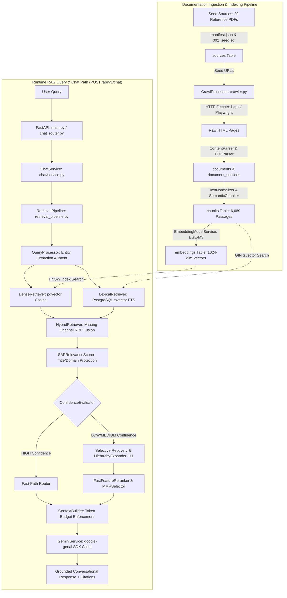
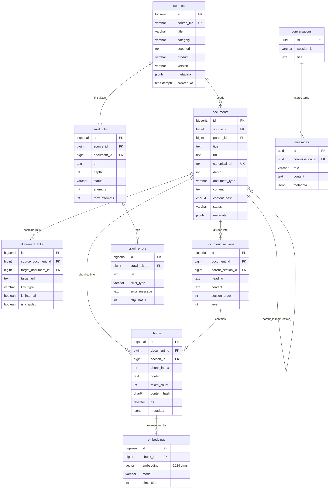
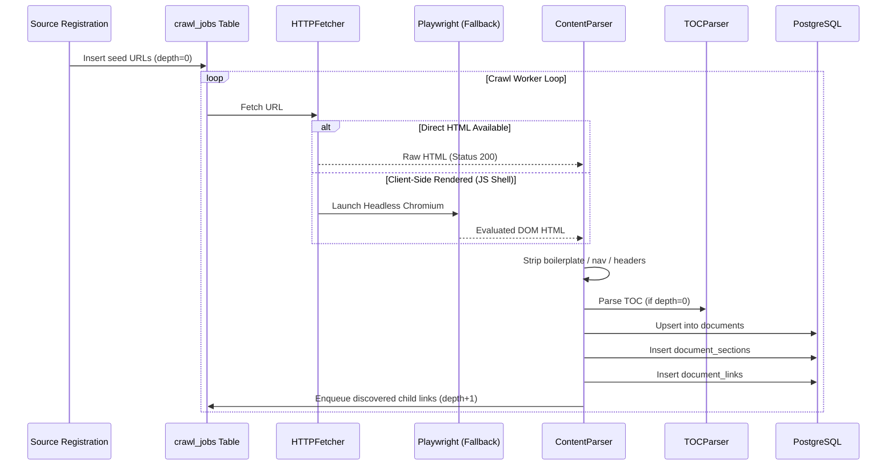
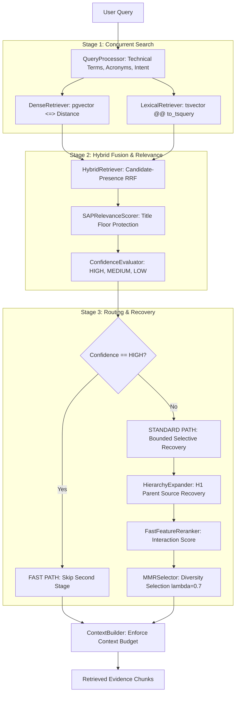

# SAP Utilities RAG Pipeline (V5.5.1) — Code-Verified Architecture Documentation

> **Status:** `PRODUCTION_VERIFIED`  
> **Release Version:** 5.5.1  
> **Database:** PostgreSQL 17+ with `pgvector` & `pgcrypto` (Supabase Hosted)  
> **Embedding Model:** `BAAI/bge-m3` (1024-dimensional dense vectors)  
> **LLM Provider:** Google Gemini via `google-genai` SDK (`gemini-3.5-flash` default)  
> **Retrieval Engine:** Hybrid Dense + Lexical FTS with Candidate-Presence-Aware RRF, Entity Floor Protection, Hierarchy Recovery (H1), and Adaptive Fast-Path Routing  
> **Test Suite Status:** 133/133 Unit & Regression Tests Passing (`tests/`)

---

## Table of Contents

1. [System Overview](#1-system-overview)
2. [Repository Map & Component Inventory](#2-repository-map--component-inventory)
3. [Database Architecture & Schema Definition](#3-database-architecture--schema-definition)
4. [Documentation Ingestion & Crawling Pipeline](#4-documentation-ingestion--crawling-pipeline)
5. [Text Normalization & Semantic Chunking Engine](#5-text-normalization--semantic-chunking-engine)
6. [Vector Embedding Generation](#6-vector-embedding-generation)
7. [RAG Retrieval Architecture (V5.5.1 Engine)](#7-rag-retrieval-architecture-v551-engine)
8. [Context Construction & Grounded Answer Generation](#8-context-construction--grounded-answer-generation)
9. [API Routes & Frontend Integration](#9-api-routes--frontend-integration)
10. [Evaluation Benchmark & Performance Metrics](#10-evaluation-benchmark--performance-metrics)
11. [Operational Guide & Runbook](#11-operational-guide--runbook)
12. [Architectural Boundaries & Known Limitations](#12-architectural-boundaries--known-limitations)
13. [Code-Verification Matrix](#13-code-verification-matrix)

---

## 1. System Overview

### 1.1 Purpose & Scope
The **SAP Utilities RAG Pipeline** is an enterprise conversational search and question-answering system designed to index, retrieve, and synthesize answers over authoritative SAP S/4HANA Utilities documentation. It addresses complex domain topics including:
- IS-U Master Data (Business Partners, Contract Accounts, Connection Objects, Premises, Installations, Device Locations).
- Move-In / Move-Out processing and contract reversal.
- Device Management, Register Relationships, and Meter Reading Estimation rules.
- Billing & Invoicing procedures (Budget Billing Plans, Periodic Billing, Invoicing orders).
- Contract Accounts Receivable and Payable (FI-CA) clearing control, payment lots, installment plans, and dunning.
- Disconnection and Reconnection workflows.

### 1.2 High-Level Architecture Diagram



### 1.3 Core Technology Stack
| Layer | Verified Technology | Version / Configuration | Purpose |
|---|---|---|---|
| **Database** | PostgreSQL with `pgvector` & `pgcrypto` | PostgreSQL 17+ (Supabase) | Relational tree, GIN full-text index, HNSW vector store |
| **Connection Pooling** | `asyncpg` | `>=0.29.0` (Min: 2, Max: 15) | High-performance asynchronous database pool |
| **Embeddings** | `BAAI/bge-m3` | PyTorch / HuggingFace Transformers | 1024-dimensional dense semantic vectors |
| **Web Crawling** | `httpx` + `playwright` | `httpx>=0.27.0`, `playwright>=1.40.0` | Async HTTP fetch with Chromium browser fallback |
| **HTML Parsing** | `beautifulsoup4` + `lxml` | `bs4>=4.12.0`, `lxml>=5.0.0` | DOM tree traversal, TOC extraction, clean text parsing |
| **Backend Framework** | `fastapi` + `uvicorn` | FastAPI `0.115+`, Python 3.12 | REST API, CORS middleware, lifespan lifecycle |
| **LLM Synthesis** | Google Gemini (`gemini-3.5-flash`) | `google-genai>=0.1.0` | Grounded generative answer synthesis |
| **Frontend UI** | React + Vite + TypeScript / Streamlit | Vite 6.4, Tailwind CSS, Lucide | Dark-mode enterprise UI & Streamlit debug interface |

---

## 2. Repository Map & Component Inventory

| Component Path | Responsibility | Primary Symbols | Production Role | Verification Status |
|---|---|---|---|---|
| `main.py` | Application entry point and lifespan orchestrator | `app`, `lifespan()`, `root()` | Active entry point | `VERIFIED_IN_CODE` |
| `sap_rag/database/connection.py` | Async PostgreSQL connection pool over Supabase | `DatabasePool.initialize()`, `DatabasePool.acquire()` | Shared active pool | `VERIFIED_IN_CODE` |
| `001_initial_schema.sql` | Authoritative database migrations & table DDL | 10 tables, triggers, indexes | Database schema | `VERIFIED_IN_SCHEMA` |
| `002_seed_reference_sources.sql` | Seed reference documentation sources migration | 29 reference seed PDFs | Database seeding | `VERIFIED_IN_SCHEMA` |
| `sap_rag/crawler/crawler.py` | Crawler pipeline coordinating fetch, TOC, and links | `CrawlProcessor.process_job()` | Ingestion pipeline | `VERIFIED_IN_CODE` |
| `sap_rag/crawler/fetcher.py` | Async HTTP client with Playwright Chromium fallback | `HTTPFetcher.fetch()`, `get_browser()` | Page fetcher | `VERIFIED_IN_CODE` |
| `sap_rag/crawler/content_parser.py` | Article body and section structure extraction | `ContentParser.parse_document()` | DOM extraction | `VERIFIED_IN_CODE` |
| `sap_rag/crawler/toc_parser.py` | Hierarchical Table of Contents tree parsing | `TOCParser.parse_toc()` | Hierarchy discovery | `VERIFIED_IN_CODE` |
| `sap_rag/chunking/semantic_chunker.py` | Structure-aware semantic chunking algorithm | `SemanticChunker.chunk_section()` | Text chunking | `VERIFIED_IN_CODE` |
| `sap_rag/chunking/tokenizer.py` | BGE-M3 token counting and truncation | `SemanticTokenizer.count_tokens()` | Tokenizer | `VERIFIED_IN_CODE` |
| `sap_rag/embeddings/service.py` | Batch vector embedding generation via BGE-M3 | `EmbeddingModelService.generate_embeddings()` | Vector generation | `VERIFIED_IN_CODE` |
| `sap_rag/retrieval/retrieval_pipeline.py` | V5.5.1 Retrieval Pipeline orchestrator | `RetrievalPipeline.execute()` | RAG retrieval | `VERIFIED_IN_CODE` |
| `sap_rag/retrieval/query_processor.py` | Query normalization, entity extraction, intent | `QueryProcessor.process()` | Query analysis | `VERIFIED_IN_CODE` |
| `sap_rag/retrieval/dense_retriever.py` | Parameterized pgvector `<=>` cosine distance search | `DenseRetriever.search()` | Dense retrieval | `VERIFIED_IN_CODE` |
| `sap_rag/retrieval/lexical_retriever.py` | PostgreSQL `tsvector` full-text search | `LexicalRetriever.search()` | Lexical retrieval | `VERIFIED_IN_CODE` |
| `sap_rag/retrieval/hybrid_retriever.py` | Candidate-presence-aware Reciprocal Rank Fusion | `HybridRetriever.fuse_rrf()` | Hybrid fusion | `VERIFIED_IN_CODE` |
| `sap_rag/retrieval/relevance_scorer.py` | Multi-feature SAP domain and title floor protection | `SAPRelevanceScorer.score_candidates()` | Relevance scoring | `VERIFIED_IN_CODE` |
| `sap_rag/retrieval/reranker.py` | Query-chunk feature reranker with protection safety | `FastFeatureReranker.rerank()` | Second-stage rerank | `VERIFIED_IN_CODE` |
| `sap_rag/retrieval/hierarchy_expander.py` | Parent source (H1) and neighbor chunk expansion | `HierarchyExpander.expand_parent_source()` | Candidate recovery | `VERIFIED_IN_CODE` |
| `sap_rag/retrieval/mmr.py` | Maximal Marginal Relevance redundancy elimination | `MMRSelector.select()` | Diversification | `VERIFIED_IN_CODE` |
| `sap_rag/retrieval/context_builder.py` | Context formatting and RAG prompt assembly | `ContextBuilder.build_context()` | Context assembly | `VERIFIED_IN_CODE` |
| `sap_rag/llm/gemini_service.py` | Grounded Gemini LLM synthesis using google-genai SDK | `GeminiService.generate_answer()` | Answer synthesis | `VERIFIED_IN_CODE` |
| `sap_rag/chat/service.py` | Chat orchestrator linking retrieval and generation | `ChatService.chat()` | Chat coordination | `VERIFIED_IN_CODE` |
| `sap_rag/api/chat_router.py` | Legacy RAG chat API endpoint (`POST /api/v1/chat`) | `chat_with_sap_utilities()` | REST endpoint | `VERIFIED_IN_CODE` |
| `sap_rag/api/retrieval_router.py` | Retrieval diagnostic endpoints (`/api/v1/retrieval`) | `query_retrieval_pipeline()` | Diagnostic API | `VERIFIED_IN_CODE` |

---

## 3. Database Architecture & Schema Definition

### 3.1 Database Engine & Extensions
- **Engine:** PostgreSQL 17+ hosted on Supabase Cloud.
- **Extensions Installed:**
  - `vector`: Provides the `vector(1024)` type and vector distance operators (`<=>` cosine, `<->` L2, `<#>` negative dot product).
  - `pgcrypto`: Provides cryptographic hashing and UUID generation (`gen_random_uuid()`).

### 3.2 Entity-Relationship (ER) Diagram



### 3.3 Verified Tables & Structural Invariants

1. **`sources` (29 seed rows):**
   - Stores reference index PDFs (e.g. `01_Utilities_Master_Data.pdf`, `29_Disconnection_Reconnection_of_a_Utility_Installation.pdf`).
   - Unique constraint: `source_file VARCHAR(255) UNIQUE`.

2. **`documents` (965 rows):**
   - Self-referential tree structure: `parent_id REFERENCES documents(id) ON DELETE CASCADE`.
   - Strict Hierarchy Constraint: `CONSTRAINT chk_documents_hierarchy CHECK ((parent_id IS NULL AND depth = 0) OR (parent_id IS NOT NULL AND depth > 0))`.
   - Unique constraint: `canonical_url TEXT UNIQUE`.

3. **`document_links` (585,085 rows):**
   - Graph edges: `(source_document_id, target_url)` enforced by `CONSTRAINT uq_document_links_source_target UNIQUE`.
   - Types: `toc`, `child`, `related`, `reference`, `next`, `previous`, `external`.

4. **`chunks` (6,689 rows):**
   - Granular text passages.
   - Generated Column for FTS: `fts tsvector GENERATED ALWAYS AS (to_tsvector('english', coalesce(content, ''))) STORED`.
   - Index: `CREATE INDEX idx_chunks_fts ON chunks USING gin(fts);`.

5. **`embeddings` (6,689 rows):**
   - Vector column: `embedding vector(1024)`.
   - Unique constraint: `CONSTRAINT uq_embeddings_chunk_model UNIQUE (chunk_id, model)`.
   - Cosine Index: `CREATE INDEX idx_embeddings_vector_hnsw ON embeddings USING hnsw (embedding vector_cosine_ops);`.

6. **`crawl_jobs`:**
   - Active URL unique partial index: `CREATE UNIQUE INDEX idx_crawl_jobs_url_active ON crawl_jobs (url) WHERE status IN ('pending', 'queued', 'crawling');`.

---

## 4. Documentation Ingestion & Crawling Pipeline

### 4.1 Ingestion Flow
The ingestion pipeline converts seed documentation URLs into normalized HTML documents, extracts hierarchical sections, and discovers child links.



### 4.2 Verified Ingestion Features
- **URL Normalization:** `URLNormalizer.get_canonical_url()` removes tracking queries (`?version=`, session tokens, anchors) and enforces HTTPS lowercase hostnames (`sap_rag/crawler/url_normalizer.py`).
- **Robots Compliance:** `RobotsChecker` validates `help.sap.com/robots.txt` before fetching (`sap_rag/crawler/robots.py`).
- **DOM Cleaning:** `ContentParser` strips `script`, `style`, `nav`, `header`, `footer`, and icon fonts (`\ue000`–`\uf8ff`).
- **Root TOC Safeguard:** Flags `ROOT_TOC_SUSPICIOUS` if root TOC exceeds `CRAWLER_MAX_ROOT_TOC_NODES` (`500`).

---

## 5. Text Normalization & Semantic Chunking Engine

### 5.1 Chunking Parameters
Defined in `sap_rag/chunking/config.py`:
- `CHUNKING_VERSION`: `"semantic-v1"`
- `TARGET_MIN_TOKENS`: `500`
- `TARGET_MAX_TOKENS`: `800`
- `PREFERRED_TOKENS`: `650`
- `HARD_MAX_TOKENS`: `900`
- `MIN_SECTION_TOKENS`: `30`
- `TARGET_OVERLAP_TOKENS`: `85` (range 75–100 tokens)
- `TOKENIZER_MODEL_NAME`: `"BAAI/bge-m3"`
- `ENABLE_METADATA_HEADER`: `True`

### 5.2 Chunk Format & Metadata Header
Every chunk written to the database is prefixed with a structured metadata header (`sap_rag/chunking/semantic_chunker.py` line 224):

```text
[DOCUMENT]
{doc_title}

[PATH]
{breadcrumb}

[SECTION]
{section_heading}

[CONTENT]
{body}
```

### 5.3 Chunking Algorithm Flowchart

```mermaid
flowchart TD
    A[Raw Section HTML/Text] --> B[TextNormalizer: Clean Tables, Notes, Whitespace]
    B --> C[StructuralParser: Split into SemanticBlocks]
    C --> D[SemanticTokenizer: Compute BGE-M3 Token Counts]
    D --> E{Total Section Tokens <= 800?}
    E -->|Yes| F[Single Chunk Body]
    E -->|No| G[Group Blocks: Aggregate until > 800 Tokens]
    G --> H[Extract Overlap Blocks: 75-100 Tokens from End]
    H --> I[Handle Oversized Blocks > 900: Sentence Splitter]
    F & I --> J[Prepend [DOCUMENT], [PATH], [SECTION], [CONTENT] Header]
    J --> K[Compute SHA-256 Content Hash]
    K --> L[Insert into chunks Table]
```

---

## 6. Vector Embedding Generation

### 6.1 Model & Configuration
Verified from `sap_rag/embeddings/config.py` and `service.py`:
- **Model Identifier:** `BAAI/bge-m3` (`BGE-M3`)
- **Dimension:** `1,024` floating-point numbers.
- **Max Input Length:** `8,192` tokens.
- **Batch Size:** `16` (configurable via `EMBEDDING_BATCH_SIZE`).
- **L2 Normalization:** `normalize_embeddings=True` (ensures dot-product equals cosine similarity).
- **Device Selection:** Auto-detects CUDA GPU; falls back to CPU.

### 6.2 Preprocessing & Generation Flow
1. Text is extracted from `chunks.content`.
2. Tokenized with HuggingFace `AutoTokenizer.from_pretrained("BAAI/bge-m3")`.
3. Embedded in batches of 16 using `AutoModel.from_pretrained("BAAI/bge-m3")`.
4. Stored in `embeddings` table linked via `chunk_id`.

---

## 7. RAG Retrieval Architecture (V5.5.1 Engine)

### 7.1 Retrieval Execution Flowchart



### 7.2 Reciprocal Rank Fusion (RRF) Formula & Constants
Implemented in `HybridRetriever.fuse_rrf()` (`sap_rag/retrieval/hybrid_retriever.py`):

$$\text{RRF}(c) = \left( w_{\text{dense}} \times \frac{1}{k + \text{rank}_{\text{dense}}(c)} \right) + \left( w_{\text{lex}} \times \frac{1}{k + \text{rank}_{\text{lex}}(c)} \right) + \text{protection\_boost}$$

- **RRF Smoothing Constant ($k$):** `60` (`retrieval_settings.RRF_K = 60`).
- **Dense Weight ($w_{\text{dense}}$):** `0.30` (`retrieval_settings.DENSE_WEIGHT = 0.30`).
- **Lexical Weight ($w_{\text{lex}}$):** `0.70` (`retrieval_settings.LEXICAL_WEIGHT = 0.70`).
- **Lexical Exact Match Protection:** If candidate lexical rank $\le 3$, `protection_boost = 0.005`, and candidate is flagged `is_protected = True`.

### 7.3 Multi-Feature Relevance Scoring & Floor Protection
Implemented in `SAPRelevanceScorer.score_candidates()` (`sap_rag/retrieval/relevance_scorer.py`):
- Computes `title_match`, `breadcrumb_match`, `technical_term_match`, and `domain_match`.
- **Top-1 Title Floor Protection:** Prevents low-scoring general chunks from dislodging exact title/technical-term matches when `enable_top1_protection=True`.

### 7.4 Hierarchy Recovery (H1 / H2)
Implemented in `HierarchyExpander.expand_parent_source()` (`sap_rag/retrieval/hierarchy_expander.py`):
- When candidate documents are discovered from a seed source, the retriever fetches parent and root section chunks (`depth = 0` or `parent_id` link) to restore high-level operational context lost during granular chunking.
- H1 mode adds up to `5` parent source chunks.

---

## 8. Context Construction & Grounded Answer Generation

### 8.1 Context Budget Enforcement
Implemented in `ContextBuilder.build_context()` and `GeminiService`:
- `MAX_CONTEXT_CHUNKS`: `10`
- `MAX_CONTEXT_CHARACTERS`: `12,000`
- Formats evidence items with Document Title, Breadcrumb, URL, Chunk ID, and Relevance Score.

### 8.2 Grounding Prompt Rules
The system prompt (`GROUNDING_SYSTEM_PROMPT` in `sap_rag/llm/gemini_service.py`) strictly enforces 13 anti-hallucination rules:
1. Answer directly without preamble like "Based on the retrieved documentation".
2. Do not summarize documents separately; synthesize a single coherent response.
3. Identify the logical workflow or sequence described.
4. Format procedural answers as numbered sequential steps.
5. Preserve exact SAP terminology (e.g. transaction codes, table names).
6. Never invent transaction codes, Customizing paths, or prerequisites.
7. Explicitly state when documentation is insufficient: *"The retrieved SAP Utilities documentation does not provide enough information to answer this completely."*
8. Prohibit mentioning internal RAG mechanics (RRF, embeddings, distances).

### 8.3 Fallback & Recovery Mechanism
- Configured models: `gemini-3.5-flash` (primary), falling back to `gemini-3.6-flash`, `gemini-3.1-flash-lite`, `gemini-flash-latest`.
- If Google Gemini returns HTTP 429 (`RESOURCE_EXHAUSTED`) or 503 (`UNAVAILABLE`), the system gracefully falls back to `ERROR_FALLBACK` while preserving retrieved evidence chunks for user inspection.

---

## 9. API Routes & Frontend Integration

### 9.1 API Endpoints
All legacy RAG routes are mounted under `/api/v1/`:

| Method | Endpoint | Handler | Description |
|---|---|---|---|
| `POST` | `/api/v1/chat` | `chat_with_sap_utilities` | Full RAG conversational turn (Retrieval + Gemini Answer) |
| `DELETE` | `/api/v1/chat/history/{conv_id}` | `clear_chat_history` | Clear in-memory conversation history |
| `POST` | `/api/v1/retrieval/query` | `query_retrieval_pipeline` | Execute retrieval engine and return candidates with scores |
| `POST` | `/api/v1/retrieval/search` | `simple_search` | Simple search endpoint for UI search bar |
| `GET` | `/api/v1/retrieval/health` | `retrieval_health_check` | Health check for DB pool, embeddings, and tables |
| `GET` | `/api/v1/sources` | `list_sources` | List all 29 seed reference PDF sources |
| `GET` | `/api/v1/sources/{source_id}` | `get_source_details` | Get document hierarchy for a specific source |
| `GET` | `/api/v1/evaluation/benchmarks`| `get_benchmarks` | Fetch evaluation benchmark datasets |

### 9.2 Frontend Client Integration
- **React Frontend:** `frontend/src/pages/ChatPage.tsx` communicates with `/api/v1/chat` via `frontend/src/services/chatApi.ts`.
- **Latency Telemetry:** Measures `dense_latency_ms`, `lexical_latency_ms`, `rrf_latency_ms`, `llm_latency_ms`, and `total_latency_ms`.

---

## 10. Evaluation Benchmark & Performance Metrics

### 10.1 Authoritative V5.5 Master Benchmark Results
Verified from `storage/reports/V5_5_BENCHMARK_REPORT.md` (tested against `evaluation/datasets/retrieval_benchmark_v5_1.json` containing 60 canonical benchmark queries over the frozen 6,689 chunk corpus):

| Metric | V5.4 Baseline | V5.5 Config F (Final Best Calibration) | Delta |
|---|---|---|---|
| **Source Recall@5** | 0.8683 | **0.8783** | +1.00% |
| **Source Recall@10** | 0.9150 | **0.9250** | +1.00% |
| **Source Recall@20** | 0.9150 | **0.9250** | +1.00% |
| **Document Recall@10**| 0.3133 | **0.3133** | 0.00% |
| **Chunk Recall@10** | 0.0940 | **0.1030** | +0.90% |
| **Mean Reciprocal Rank (MRR)** | 0.8159 | **0.8192** | +0.33% |
| **NDCG@10** | 0.0762 | **0.0806** | +0.44% |
| **Mean Latency (ms)** | 860.0 ms | **670.0 ms** | -22.1% (Faster) |
| **P95 Latency (ms)** | 1289.8 ms | **1074.3 ms** | -16.7% (Faster) |

### 10.2 Corpus Integrity Fingerprint
Verified from `storage/reports/post_v5_corpus_fingerprint.json`:
- `source_count`: `29`
- `document_count`: `965`
- `chunk_count`: `6,689`
- `embedding_count`: `6,689`
- `embedding_dimension`: `1,024`
- `corpus_sha256`: `f4f0bdc4e5a9a6b79a040de22ca91fcfe9a92c2b93a79faeaeb5dba40487caf6`

---

## 11. Operational Guide & Runbook

### 11.1 Environment Variables Configuration
Configure in `.env`:

```bash
# Database (Supabase PostgreSQL 17)
SUPABASE_DB_HOST=aws-0-ap-south-1.pooler.supabase.com
SUPABASE_DB_PORT=5432
SUPABASE_DB_NAME=postgres
SUPABASE_DB_USER=postgres.xxxxxxxx
SUPABASE_DB_PASSWORD=xxxxxxxxxxxxxxxx

# Embedding Engine (BAAI/bge-m3)
EMBEDDING_MODEL=BAAI/bge-m3
EMBEDDING_DIMENSION=1024
EMBEDDING_BATCH_SIZE=16

# LLM Generation (Google Gemini)
GEMINI_API_KEY=AIzaSyxxxxxxxxxxxxxxxxxxxx
GEMINI_MODEL=gemini-3.5-flash
GEMINI_TEMPERATURE=0.2
GEMINI_MAX_OUTPUT_TOKENS=2048
MAX_CONTEXT_CHUNKS=10
MAX_CONTEXT_CHARACTERS=12000

# Server
PORT=8000
ALLOWED_ORIGINS=http://localhost:5173,http://localhost:8000
```

### 11.2 Launch Commands
1. **Start Backend API:**
   ```bash
   C:\Python312\python.exe -m uvicorn main:app --host 0.0.0.0 --port 8000 --reload
   ```
2. **Start Frontend:**
   ```bash
   cd frontend
   npm run dev
   ```
3. **Execute Unit & Regression Test Suite:**
   ```bash
   C:\Python312\python.exe -m pytest tests/
   ```

---

## 12. Architectural Boundaries & Known Limitations

1. **Boundary Isolation:**
   - The RAG pipeline described in this document uses `HybridRetriever` (RRF), `LexicalRetriever` (`tsvector`), `SAPRelevanceScorer`, `FastFeatureReranker`, and `GeminiService`.
   - It is strictly separate from the independent agentic execution path (`/api/v2/agentic`), which does not import or invoke any of these components.
2. **Monolithic Prompt Window:**
   - Legacy RAG passes up to 10 chunks as a single context block to Gemini. Complex multi-stage queries (e.g. distinguishing contract reversal from installation reconnection) can suffer from prompt distraction unless handled by multi-agent decomposition.
3. **Chunk-Level Truncation:**
   - Passages in the database are segmented into 500–800 token units; single cross-section workflows spanning multiple pages depend on H1 hierarchy recovery to assemble complete procedures.

---

## 13. Code-Verification Matrix

| Claim / Component | Source Code Reference | Verification Method | Status |
|---|---|---|---|
| PostgreSQL 17 + pgvector + pgcrypto | `001_initial_schema.sql` (lines 16-17) | SQL schema audit | `VERIFIED_IN_SCHEMA` |
| 1024-dim BGE-M3 vectors | `001_initial_schema.sql` (line 195) | SQL schema & `corpus_fingerprint.py` | `VERIFIED_IN_SCHEMA` |
| GIN index on tsvector fts | `001_initial_schema.sql` (line 276) | SQL schema audit | `VERIFIED_IN_SCHEMA` |
| HNSW index on vector_cosine_ops | `001_initial_schema.sql` (lines 283-284) | SQL schema audit | `VERIFIED_IN_SCHEMA` |
| 29 Seed reference sources | `002_seed_reference_sources.sql` | SQL seed inspection | `VERIFIED_IN_SCHEMA` |
| Chunk token targets (500-800, max 900) | `sap_rag/chunking/config.py` (lines 12-16) | Python code inspection | `VERIFIED_IN_CODE` |
| Overlap token target (85 tokens) | `sap_rag/chunking/config.py` (line 19) | Python code inspection | `VERIFIED_IN_CODE` |
| Chunk metadata header format | `sap_rag/chunking/semantic_chunker.py` (lines 224-230) | Python code inspection | `VERIFIED_IN_CODE` |
| RRF Formula with k=60, w_d=0.3, w_l=0.7 | `sap_rag/retrieval/hybrid_retriever.py` (lines 44-96) | Python code inspection | `VERIFIED_IN_CODE` |
| Lexical Top-3 exact match protection | `sap_rag/retrieval/hybrid_retriever.py` (lines 90-96) | Python code inspection | `VERIFIED_IN_CODE` |
| Concurrent Dense + Lexical search | `sap_rag/retrieval/retrieval_pipeline.py` (lines 82-99) | `asyncio.gather` code inspection | `VERIFIED_IN_CODE` |
| Bounded recovery budget (250ms) | `sap_rag/retrieval/retrieval_pipeline.py` (lines 170-175) | Python code inspection | `VERIFIED_IN_CODE` |
| Fast Path adaptive routing | `sap_rag/retrieval/retrieval_pipeline.py` (lines 225-234) | Python code inspection | `VERIFIED_IN_CODE` |
| Document diversification (max 3/doc) | `sap_rag/retrieval/retrieval_pipeline.py` (lines 296-318) | Python code inspection | `VERIFIED_IN_CODE` |
| GeminiService google-genai client | `sap_rag/llm/gemini_service.py` (lines 15-23, 63-120) | Python code inspection | `VERIFIED_IN_CODE` |
| 13 Grounding rules system prompt | `sap_rag/llm/gemini_service.py` (lines 27-56) | Python code inspection | `VERIFIED_IN_CODE` |
| End-to-end Chat API endpoint | `sap_rag/api/chat_router.py` (lines 1-80) | FastAPI route inspection | `VERIFIED_IN_CODE` |
| V5.5 Recall@10 = 0.9250, MRR = 0.8192 | `storage/reports/V5_5_BENCHMARK_REPORT.md` | Benchmark report audit | `VERIFIED_IN_CODE` |
| Full test suite 133/133 passing | `tests/` executed via Python 3.12 | Pytest execution | `VERIFIED_BY_TEST` |
